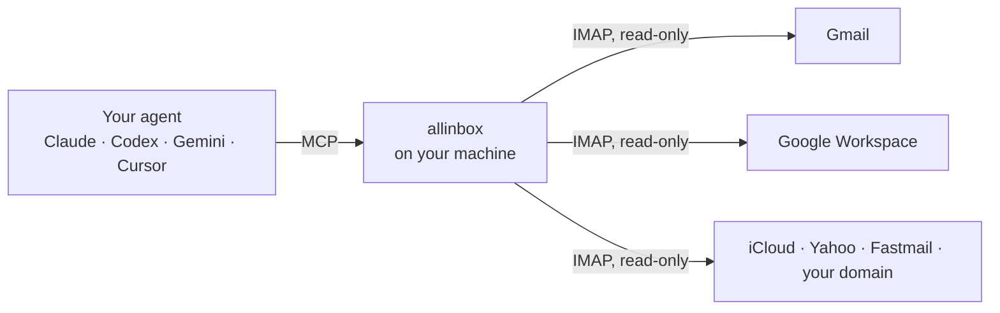

<div align="center">

# allinbox

**All your inboxes, one query, any agent.**

Let Claude, Codex, Gemini or Cursor search every email account you have, in a single call.
Free, open source, and it runs on your machine.

[](https://github.com/tomasbenavidez/allinbox/actions/workflows/ci.yml)
[](LICENSE)
[](https://nodejs.org)
[](https://modelcontextprotocol.io)
[](#security)


</div>

---

## Why

You have a work inbox, a university one, a personal one and that old address you never closed.
Your AI agent's built-in email connector reaches **one** of them.

allinbox gives the agent all of them at once:

```text
You:    What do I have pending this week across all my email?

Agent:  • Thesis review moved to Friday              (uni)
        • Invoice #2041 is due Thursday               (work)
        • Ana: "Q4 budget, can you check slide 3?"    (work · also in personal)
        • Flight check-in opens tomorrow              (personal)
```

## Quick start

```bash
npx allinbox
```

<sub>Using another package manager? `pnpm dlx allinbox` or `bunx allinbox` work the same.</sub>

A guided setup (English / Español) does the rest:

1. **Add your accounts.** It recognizes your provider, including Google Workspace and Microsoft 365 domains such as a university or company address. It opens the right page in your browser to create an **app password**, already signed in to the right account, and checks the login before saving anything.
2. **Drafts (optional).** Let your agent leave reply drafts, only to recipients you allow.
3. **Connect your agents.** It finds Claude Code, Claude Desktop, Cursor, Gemini CLI and Codex on your machine and registers allinbox in each one, backing up their config first.

Restart your agent and ask it anything about your mail.

> **What's an app password?** A separate password just for allinbox. You can revoke it anytime without touching your real password.
> Gmail needs 2-Step Verification turned on first; the setup walks you through it.

## What you can ask

- *"What do I have pending this week across all my email?"*
- *"Did anyone reply about the internship, in any account?"*
- *"Summarize the whole thread with Ana about the Q4 budget."*
- *"Draft a reply to the landlord saying Tuesday works."* (drafts enabled)

## How it works



One `search_all` call fans out to every account in parallel. A slow account times out on its own without blocking the rest. Results are merged, duplicates are collapsed (same `Message-ID` across accounts), and everything is cleaned before your agent sees it: no quoted replies, signatures, HTML or kilometer-long tracking links. Your agent reads more mail with fewer tokens.

## Works with

| Agents | Email providers |
|---|---|
| Claude Code, Claude Desktop | Gmail, Google Workspace |
| Codex | iCloud, Yahoo, AOL |
| Gemini CLI | Fastmail, Zoho, GMX |
| Cursor, VS Code, any MCP client | Any IMAP server (your own domain) |

## Tools

| Tool | What it does |
|---|---|
| `list_accounts` | The accounts allinbox can search |
| `search_all` | One query across every account. `query`, `since_days` (30), `limit` (25), optional `accounts` |
| `read_email` | One message by id, cleaned. `max_chars` (4000) |
| `read_thread` | The whole conversation, oldest first, in one call. `max_chars` (8000) |
| `create_draft` | **Only if you enabled drafts.** Saves to your Drafts folder and **never sends**. `reply_to_id` threads it |

On Gmail, `query` accepts Gmail search syntax (`from:ana has:attachment`).

## Security

Giving an AI access to your email deserves a straight answer:

- **It cannot send.** There is no SMTP code in allinbox at all. Mailboxes are opened read-only (IMAP `EXAMINE`), so nothing is deleted, moved or even marked as read.
- **Drafts are opt-in** and limited to recipients you approve. They land in your Drafts folder for you to review.
- **Prompt-injection aware.** Every email reaches the agent wrapped in a tag with a random per-session id that a malicious email can't forge, together with an instruction never to follow orders found inside an email.
- **Local only.** No server, no account, no telemetry. Passwords live in your OS keychain (Windows Credential Manager, macOS Keychain, libsecret). `~/.allinbox/config.json` holds only hosts and usernames.
- **Pinned.** Agents are registered with an exact version, so a future release never runs without you re-running setup.

## Install as a plugin or extension

Run `npx allinbox` once first to add your accounts. Then, instead of letting the setup edit
your agent's config:

**Claude Code plugin** (includes a skill that teaches Claude how to use allinbox)
```bash
claude plugin marketplace add tomasbenavidez/allinbox
claude plugin install allinbox@allinbox
```

**Gemini CLI extension**
```bash
gemini extensions install https://github.com/tomasbenavidez/allinbox
```

**Claude Desktop**: download `allinbox.mcpb` from the [latest release](https://github.com/tomasbenavidez/allinbox/releases/latest) and open it (or drag it into Settings → Extensions).

## Connect an agent manually

The setup does this for you. If you prefer to do it by hand:

**Claude Code**
```bash
claude mcp add --scope user allinbox -- npx -y allinbox serve
```

**Claude Desktop · Cursor · Gemini CLI · VS Code**: add this to the client's MCP config
(`claude_desktop_config.json`, `~/.cursor/mcp.json`, `~/.gemini/settings.json`).
Close Claude Desktop first: it rewrites its config while it runs.
```json
{ "mcpServers": { "allinbox": { "command": "npx", "args": ["-y", "allinbox", "serve"] } } }
```

**Codex** (`~/.codex/config.toml`)
```toml
[mcp_servers.allinbox]
command = "npx"
args = ["-y", "allinbox", "serve"]
```

On Windows, use `"command": "cmd"` with `"args": ["/c", "npx", "-y", "allinbox", "serve"]`.

## CLI

```text
allinbox              guided setup (in a terminal) / MCP server (when an agent runs it)
allinbox add          add one account
allinbox connect      connect allinbox to your installed agents
allinbox list         show accounts and draft settings
allinbox test [id]    check that accounts can log in
allinbox remove <id>  remove an account and its stored password
```

## FAQ

**Does my email go through any server?**
No. allinbox talks IMAP directly from your computer to your provider. What your *agent* does with the text it reads is up to the agent you use.

**Outlook, Hotmail or Microsoft 365?**
Not yet. Microsoft blocks password logins for these accounts, so they need OAuth, which is next on the [roadmap](ROADMAP.md).

**Gmail says "The setting you are looking for is not available for your account".**
Turn on 2-Step Verification first. On school or company Google accounts, your administrator may have disabled app passwords entirely.

**Why not Gmail OAuth instead of app passwords?**
Google requires a paid yearly security assessment before an app can read Gmail through a shared OAuth client. App passwords keep allinbox free, local and set up in two minutes.

## Roadmap

Token benchmark · local full-text index for years of mail · Outlook OAuth · one-click install bundles for every agent. See [ROADMAP.md](ROADMAP.md).

## Contributing

Issues and PRs are welcome.

```bash
pnpm install
pnpm test     # unit tests + IMAP integration tests against GreenMail in Docker
pnpm build
```

Please read the invariants in [CLAUDE.md](CLAUDE.md) before touching anything near sending, flags or the untrusted-content wrapper.

## License

[MIT](LICENSE) © Tomás Benavidez
